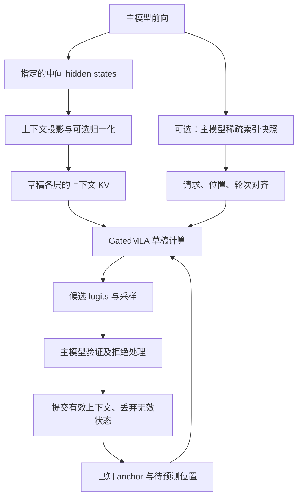

# GatedMLA 与 DFlash：在 vLLM Ascend 0.20.2rc 上的适配思路

本文讨论一个假设场景：草稿模型采用 GatedMLA，通过 DFlash 方式生成候选，可能使用 SWA、Sink，并复用主模型的部分 hidden states 或稀疏索引。重点是如何在 `releases/v0.20.2rc` 上组织改动、对齐语义和验证正确性。

不绑定具体模型，不给出实际层数、维度、层编号、权重或部署配置。下文新模块、新类和新接口名称都是建议命名，不代表 release 已经提供这些能力。本文是设计说明，不是已经通过真实模型运行验证的实现。

## 1. 先理解 MLA、GatedMLA 与 Sink

### MLA：压缩表示与注意力计算

MLA（Multi-head Latent Attention）的核心是利用低秩潜在表示组织 K/V。相对于缓存每个 head 展开的完整 K/V，可以保存压缩 latent，以及实现所需的位置编码部分，在计算时使用对应投影。

可按以下路径理解一种典型结构：

- Q 路径：输入 → 查询投影或低秩投影 → 可选归一化 → 查询展开。
- KV 路径：输入 → 压缩投影 → latent 归一化 → 对应的 K/V 展开。
- 位置路径：把需要 RoPE 的部分与不需要 RoPE 的部分分开处理。
- 注意力输出：按对应公式计算分数、归一化、聚合 V，再做输出投影。

Q 是否低秩、归一化位置、RoPE 布局和各维度都不是仅凭“MLA”就能确定的。尤其不能把 Q/K 维度直接当作 V 维度。

参考实现可以显式展开 K/V 来对照计算；生产实现可以采用权重吸收或专用算子。两者必须在同一数学约定下等价，不能把“显式展开”的临时内存收益当作原生 MLA 的实际性能。

### GatedMLA：在 MLA 上增加门控

GatedMLA 通常指带门控的 MLA。除 MLA 的表示与缓存方式外，还增加输入相关的门值，调节注意力结果的强度。

一种常见但并非唯一的形式是：

`y = o_proj(g ⊙ attention_output)`

其中 `g` 可以由某个输入投影后经过 sigmoid 得到，`⊙` 表示逐元素相乘。

| 对比项 | MLA | GatedMLA |
| --- | --- | --- |
| 主要机制 | 用低秩表示组织 K/V 与注意力计算 | 在 MLA 基础上增加输出调节机制 |
| 额外参数 | 取决于 MLA 投影布局 | 可能增加独立 gate 投影，也可能与已有投影融合 |
| 门控粒度 | 不要求额外门控 | 可以是每 head 一个门值，或每 head 的每个通道一个门值 |
| 缓存 | 根据 latent 与位置编码布局确定 | 若只门控 attention 输出，通常不因此增加持久 KV 内容 |
| 适配重点 | 压缩投影、RoPE、缓存和算子公式 | 还要核对 gate 输入、激活、广播与乘法位置 |

不能假定所有 GatedMLA 都采用上面的公式。若 gate 作用于 Q、K/V 或输出投影之后，计算和缓存影响需要重新分析。注意力 gate 也不是 FFN 中 SwiGLU 的 gate，两者应分别处理。

### Sink：必须区分两类机制

**第一类是保留上下文 token。** 某些设计让开头的若干 token 始终可见，作为 attention sinks；即使滑动窗口已经移到后面，这些位置仍可参与注意力。这些 token 有正常 K/V，既占用概率，也贡献输出。观察到某些 token 自然吸收注意力，与主动在窗口策略中保留它们，属于相关但不同的事情。

**第二类是可学习的 sink logit。** 给 softmax 增加一个可学习的分数，但不增加普通的 V 贡献。对一个 head，设真实 token 的分数为 `s_j`，sink 分数为 `s_sink`，则一种常见定义是：

`p_j = exp(s_j) / (sum_k exp(s_k) + exp(s_sink))`

`output = sum_j p_j * V_j`

这里真实 token 的权重和可以小于 1；剩余概率相当于分给一个零值选项。实现中可用数值稳定的归一化计算，不应直接照搬指数表达式计算大分数。

| 问题 | 保留 token 的 sink | 可学习 sink logit |
| --- | --- | --- |
| 有正常的 K/V 吗 | 有 | 在上述定义下没有普通 V 贡献 |
| 是否占用真实序列位置 | 是 | 不应伪造为普通 token 位置 |
| 修改哪里 | 缓存保留规则与可见性 mask | softmax 归一化与对应参数加载 |
| 与 SWA 的关系 | 可按模型约定绕过局部窗口 | 不等价于放开窗口外的某个 token |

### 用一个数字例子理解 learned sink

假设一个 query 关注两个真实 token，两个分数都为 0。以下数字只用于解释 softmax，不是模型配置。

- 没有 sink：两个 token 各获得一半概率，输出是 `0.5 * V1 + 0.5 * V2`。
- 增加一个分数也为 0 的 sink：三个选项各获得三分之一概率。sink 的值为零，因此输出是 `(V1 + V2) / 3`。
- sink 分数继续升高：它分走更多概率，真实 token 的总权重进一步下降。

它相当于给注意力增加了一个“这部分权重不分配给任何实际 token”的选项。它不会因为名称叫 sink 就自动挑出无用 token，也不会自动保留序列开头。对于单个 head，固定真实 token 分数时，它不改变这些 token 彼此的权重比例，只改变分给它们的总权重。

设没有 sink 时真实分数的指数和为 `Z`，则上述 learned sink 输出等于普通 attention 输出乘以 `Z / (Z + exp(s_sink))`。因此它具有整体缩放效果，但这个缩放依赖当前 query 对真实 token 的分数。即使 `s_sink` 是训练后固定的每 head 参数，缩放系数仍可能随 query 改变。

**它与 GatedMLA 的 gate 有什么区别？** learned sink 在 softmax 的分母里分走概率；常见的输出 gate 在 attention 聚合之后乘到结果上，可以按 head 或通道分别调节。两者可能同时存在，但不能在未证明等价时互相替换。以上“减弱输出”指 attention 分支，最终层输出还受到输出投影和残差连接的影响。

因此，配置只写 `sink=true` 不够。必须明确属于哪种机制、是否同时使用两种，以及作用在哪些层或 head。

## 2. 假设系统的数据流

这是设计关系，不代表所有模型都必须共享 hidden states 和索引。共享中间特征的来源层配置，与稀疏索引的来源层映射，应独立定义。

## 3. 0.20.2rc 中已经存在什么、还缺什么

以下源码结论基于本次检查的 `releases/v0.20.2rc` 分支。分支会移动，实际实施时应记录本地 checkout 的提交，并同时核对配套 vLLM 版本；发行版本名称本身不足以锁定全部接口。

| 现有入口 | 已核对的行为 | 对适配的影响 |
| --- | --- | --- |
| `spec_decode/__init__.py::get_spec_decode_method` | `dflash` 路由到 `AscendDflashProposer` | 需要为新架构增加明确分流 |
| `spec_decode/dflash_proposer.py::AscendDflashProposer` | 每请求准备 `1 + num_speculative_tokens` 个 query；设置非因果 metadata | 可参考输入准备，但仍需核对新模型块内可见性与采样位置 |
| `spec_decode/llm_base_proposer.py::_propose` | EAGLE3/DFlash 路径对模型类执行类型断言，并调用 `combine_hidden_states` | 仅注册新类不够，必须处理类型限制和特征接口 |
| 同文件 `load_model` | 从 `AttentionLayerBase` 查找草稿 attention 层，读取第一层 backend | 普通张量模块或私有缓存不能直接走这套初始化 |
| 同文件 `_propose` | 通过 `draft_attn_groups[0]` 取得 metadata builder | 新 cache 布局要么正确接入分组，要么有独立执行路径 |
| 同文件 `prepare_inputs_padded` | 拒绝 token 可以作为 padding 留在输入中 | 不能把收到的全部 hidden 行直接写成有效上下文 |
| `worker/model_runner_v1.py` | 辅助 hidden 输出开关、层选择与 drafter 调用分散在不同位置 | 必须同时接通初始化、加载与运行路径 |

公开源码阅读入口：[DFlash proposer](https://github.com/jiajinzhu2/vllm-ascend/blob/releases/v0.20.2rc/vllm_ascend/spec_decode/dflash_proposer.py)、[公共 proposer](https://github.com/jiajinzhu2/vllm-ascend/blob/releases/v0.20.2rc/vllm_ascend/spec_decode/llm_base_proposer.py)、[runner](https://github.com/jiajinzhu2/vllm-ascend/blob/releases/v0.20.2rc/vllm_ascend/worker/model_runner_v1.py)。

## 4. 建议新增的模块

建议先组织一个独立的 `vllm_ascend/gated_mla_dflash/` 模块，命名仅作示例。

| 建议文件 | 职责 | 必须说清的约定 |
| --- | --- | --- |
| `contract.py` | 配置验证与能力检查 | 维度、gate、Sink、窗口、索引语义、层编号和候选布局 |
| `model.py` | GatedMLA、上下文投影、decoder 与权重加载 | 网络公式、缓存内容及输入输出形状 |
| `index_bridge.py` | 主模型索引到草稿模型的传递 | 请求 ID、逻辑位置、来源层、执行轮次与失效规则 |
| `proposer.py` | 候选输入组织、草稿执行与 logits 输出 | 与 release runner 的参数、返回值及有效行映射 |

可以把模型内部职责拆为 `combine_hidden_states`、`update_context`、`decode_request`、`compute_logits` 和 `load_weights`。除 release 已使用的接口外，这些都是建议的内部设计，不能据此假定框架会自动调用它们。

## 5. 在 0.20.2rc 上按文件怎么改

### 5.1 模型注册：`vllm_ascend/models/__init__.py`

在 `register_model` 中新增草稿架构到实现类的映射，例如把自定义的 `GatedMLADFlashForCausalLM` 映射到新增模块。

随后核对实际使用的 vLLM 配置解析、架构识别和模型 loader 是否接受该架构。注册 Ascend 实现不会自动解决上游配置校验、词表映射或 speculative method 推断。

权重加载需要严格报告缺失项、多余项与 shape 不一致；融合 Q/gate、融合 gate/up 或转置权重必须按已确认布局转换，不能用 reshape 或跳过参数掩盖差异。

### 5.2 Proposer 路由：`vllm_ascend/spec_decode/__init__.py`

在 `get_spec_decode_method` 的 `dflash` 分支中，根据草稿配置的明确架构标识选择专用 proposer。其他草稿架构继续使用原有 proposer。

不建议把所有 DFlash 请求统一换成新实现，也不应仅凭出现某个 gate 配置字段就断定模型符合完整接口。

### 5.3 专用 proposer 与公共 proposer：选择一条清楚的接入路径

**路径 A：先建立 eager 参考实现。** 可以在确认父类构造行为可复用后，继承 `AscendDflashProposer`，用专用 `load_model`、`_propose`、`initialize_attn_backend`、`dummy_run` 管理参考执行。该方案需要同步修改 runner 对 attention 层和 cache metadata 的假设。

- `load_model`：加载与校验草稿模型，处理上下文投影，分配有容量限制的参考缓存。
- `_propose`：使用明确的请求/位置映射过滤有效上下文，准备候选，执行草稿并返回 runner 约定的结果。
- `initialize_attn_backend`：显式区分参考缓存与原生 backend 路径；如果采用私有缓存，不能伪造一个空 attention 组让公共代码继续访问。
- `dummy_run`：覆盖实际采用的计算和主要工作区，使内存 profiling 有意义；不能只返回空结果。

这一路径可以绕开公共 `_propose` 的模型类型断言，但必须审查所有继承方法是否还访问 `attn_layer_names[0]`、`draft_attn_groups[0]` 或依赖原生 slot mapping。

**路径 B：直接接入原生 attention/cache。** 实现框架可发现的 attention 层及 cache spec，完成 backend、分组、block table、slot mapping 和 metadata builder 的配套工作，再让公共路径接受新模型接口。

如果修改 `llm_base_proposer.py`，应将硬编码类型约束替换为明确的能力接口检查或经过验证的支持范围，并核对各 cache group 的 metadata。不能只删除断言：后续特征拼接、KV 写入和 attention builder 仍可能不兼容。

路径 A 适合先查清计算差异；路径 B 是与调度、缓存复用和高性能算子集成的方向。二者都需要完成验证，不能把“绕开断言”当成适配完成。

### 5.4 Runner：`vllm_ascend/worker/model_runner_v1.py`

需要连起来检查以下位置：

1. **drafter 初始化**：如果新架构依赖 auxiliary hidden states，为该路径设置 `use_aux_hidden_state_outputs`。当前相关分支不能自动涵盖任意新架构。
2. **`load_model` 的辅助层设置**：从新模型的配置取得捕获层，调用主模型支持的捕获接口。现有路径使用 EAGLE3 辅助特征接口，不能因此假定所有主模型都支持它，也不能自动采用其默认层。
3. **层编号约定**：区分 backbone 层号与 hidden-state 捕获编号；是否需要偏移取决于主模型实际接口，不能统一加一。
4. **target forward 前后**：如果共享索引，安装本轮 recorder，并在正确生命周期内保存结果。异常或结束时清理状态。
5. **验证后的 drafter 调用**：将有效 hidden、位置、请求顺序以及接受/拒绝信息传给专用 proposer。数据经过 compact 或重排时，索引快照也要按同一映射处理。
6. **公共 attention metadata 的选择**：当前逻辑会读取 `self.drafter.attn_layer_names[0]`。参考草稿没有原生 attention 层时，应建立专用分支，明确使用哪一组 target metadata；不能盲目取第一组或构造虚假层名。
7. **后端初始化与 profiling**：核对 drafter 类型检查及 `initialize_attn_backend` 调用，保证所选路径可以初始化、计量内存并清理资源。

最终交给 sampler/rejection sampler 的 token、logits、概率信息和形状，必须保持该版本要求的约定。贪心模式跑通不等于概率采样已经正确。

### 5.5 主模型稀疏索引：`vllm_ascend/attention/sfa_v1.py`

如果主模型使用 DSA，并且运行时确实经过此后端，可在 `topk_indices` 已生成或已复用之后、调用 `_execute_sparse_flash_attention_process` 之前增加采集入口。

该位置要覆盖两种情况：本层执行 indexer 产生 top-k，以及 `skip_topk` 分支从缓存复用 top-k。只改 indexer 计算分支会漏掉后者。[SFA 源码](https://github.com/jiajinzhu2/vllm-ascend/blob/releases/v0.20.2rc/vllm_ascend/attention/sfa_v1.py)

采集时应记录来源层，并处理共享 buffer 被覆盖的问题。若 indexer、快照复制与草稿计算使用不同执行流，需要正确的事件依赖；拿到 tensor 引用不代表计算已经完成。

若实际采用其他 attention 后端，应把入口放到那个后端的等价位置。文件中存在 hook，不代表实际运行经过它。

## 6. SWA、Sink 与 index share 如何共同适配

### SWA：先写清集合，再写 mask

对于 query 位置 `p` 和历史位置 `t`，一种因果历史窗口可以定义为 `0 <= p - t < W`。这只是窗口约定示例，是否包含当前位置、窗口左右边界如何定义，应与模型公式一致。

历史上下文与当前候选块应分别处理。release 的 DFlash 设置非因果 metadata，不意味着所有历史位置和所有候选位置都能无条件互相访问；还要同时满足训练使用的 mask、有效 token 范围和窗口规则。

### Sink：分别改可见性和归一化

- prefix sink：按约定保留前缀 K/V，并把这些合法位置加入历史可见集合。
- learned sink logit：加载对应参数，将它纳入 softmax 归一化，但不把它当作普通历史 token 写入缓存。
- 两者并存：分别实现，避免在 mask 和 softmax 两处重复表达同一种机制。

### Index share：明确到底共享什么

| 共享方式 | 需要设计的接口 | 主要风险 |
| --- | --- | --- |
| 共享 top-k 结果 | 来源层、query 行、请求内逻辑位置和轮次 | 用错请求或使用过期结果 |
| 共享 indexer 权重 | 参数绑定、输入布局和并行切分 | 权重相同不代表输入特征相同 |
| 共享 index KV/cache | cache spec、所有权、地址与生命周期 | 把物理地址误当逻辑位置 |

如果设计允许把最后一个有效 target query 的 top-k 用于整块候选，可以实现这种广播；但这是一个需要确认的模型假设，不能从“支持 index share”直接推导。如果每个未来 query 都要求不同索引，就需要逐 query 的结果或独立计算。

推荐先转成请求内逻辑 token 位置，再映射到草稿缓存。拒绝行、padding、compact 后行号和原始 target forward 行号不是同一个概念。

若同时存在窗口与稀疏索引，应明确取交集还是并集，然后按约定加入 prefix sink，并处理候选块可见性。不同组合对应不同模型行为，不是可以随意切换的性能选项。

## 7. DFlash 候选布局与缓存更新

该 release 的输入组织使用每请求 `1 + K` 个 query。应沿着输入准备、采样索引和 runner 返回值确认 anchor 与候选的位置关系，而不是看到 `K + 1` 就自行选取固定 logits 切片。

适配时同时确认：mask token 的定义、位置编码、上下文投影、候选块 attention mask、输出位置到候选 token 的映射，以及主模型验证后的推进规则。DFlash 与其他草稿算法不能因结构相似就混用专有的 confidence 或 Markov 接口。

缓存更新要区分三个状态：已确认的 target 上下文、当前待验证候选、当前起草时的临时 mask/query 表示。

- 仅把语义有效的上下文提交到持久草稿缓存。
- 不要将包含拒绝 padding 的全部 target hidden 行直接写入缓存。
- 若训练要求草稿上下文来自 target hidden，下一轮应按有效 target hidden 更新；不能把上一轮 mask query 的 KV 当成等价上下文。
- 请求取消、结束、抢占和恢复都需要明确协议；私有参考缓存不自动具备框架分页缓存的恢复能力。

## 8. 从参考实现到原生算子的迁移

先验证正确性时，可以限制为 eager、有限上下文、简单并行配置和明确的请求数量。遇到尚未实现的调度或缓存模式，应显式拒绝或禁用该模式。

进入性能实现时，再依次完成：

1. cache spec、KV 分组、slot mapping 和内存计量。
2. GatedMLA 投影与 gate 的算子实现，核对权重融合布局。
3. SWA、稀疏索引及 Sink 的组合语义与 backend 支持。
4. 张量并行下的权重切分、head 布局、通信及 logits 处理。
5. 图执行与异步调度下的索引生产、消费和生命周期。
6. prefix cache、抢占、恢复及其他调度能力。

用 dense attention 算出全部历史分数后再加稀疏 mask，可以用于参考对照，但不会自动获得稀疏算子的计算复杂度收益。

## 9. 推荐的验证顺序

| 阶段 | 验证内容 | 需要观察的结果 |
| --- | --- | --- |
| 结构与配置 | Q/K/V、latent、gate、Sink、RoPE 和词表映射 | 未知项明确报错，shape 与公式一致 |
| 单层数值 | 投影、归一化、门控前后、attention 输出 | 参考计算与适配实现的误差可解释 |
| 可见性边界 | SWA 边界、prefix sink、learned sink、稀疏组合 | 不同机制没有被错误合并 |
| 单请求闭环 | prefill、连续生成、全接受、部分接受、拒绝 | token 位置与缓存推进一致 |
| 索引生命周期 | 来源层、重排、padding、无效索引与过期轮次 | 不串请求、不消费旧快照 |
| 多请求与调度 | 不同长度、重排、取消、恢复 | 缓存隔离与资源回收正确 |
| 采样与性能 | 贪心及需要支持的概率模式、端到端耗时 | 正确性成立后再评估加速收益 |

建议最先打通“模型注册 → 专用 proposer → hidden 捕获 → 单请求候选 → 主模型验证”的闭环，再逐项加入 SWA、Sink、index share 和性能优化。每新增一个机制，都保留可独立对照的中间结果。
